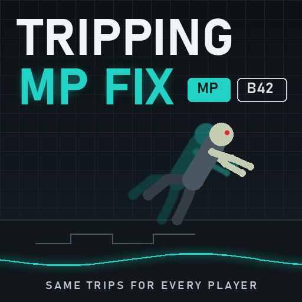

# Tripping Zombies MP Fix [B42]

An add-on for [Tripping Zombies](https://steamcommunity.com/sharedfiles/filedetails/?id=3746603021) (by turnip):
in multiplayer every player sees the same trips and falls, at the same moment, without teleports.
Tripping Zombies itself is not changed and none of its code is copied; this is a separate Lua mod.

**Steam Workshop:** https://steamcommunity.com/sharedfiles/filedetails/?id=3829034899 · **Source code (MIT):** https://github.com/druidqwerty/TrippingZombiesMPFix

Free and open source. The code is written by an AI; the direction, the testing and the time are mine. If the mod made your game better: [support on Boosty](https://boosty.to/lrgpp).

Русская версия: [README_RU.md](README_RU.md)

## The problem

In Build 42 multiplayer every zombie near a player is run by one game: the game of the player it chases.
Everybody else sees a copy that follows that game's updates. Tripping Zombies keeps its logic in
`media/lua/server`, but B42 loads that folder on every player's game as well, and the server itself never
updates zombies. So in multiplayer each game trips the zombies on its own:

- a zombie chasing your friend trips only on your friend's screen; on yours it keeps running (and the other
  way round) — with the author's settings in our test, the other player saw **0 of 198** trips;
- with "trip only while chasing" off (Tripping Zombies' default), your game also trips its own copies of your
  friend's zombies: they fall on your screen while the real ones run on, and the game teleports the lying
  copy every 3 tiles;
- knockdowns from hits (shoves, melee, gunshots) never happen at all: the server rolls them and queues the fall
  for its own copy of the zombie, which it never updates.

## What the add-on does

- Tripping Zombies rolls a zombie's trips only in the game that runs that zombie.
- Every change it makes to the zombie there (knockdown, bump, stagger, fall direction) is recorded and sent
  through the server to the other players. Their copy gets the same calls a moment later: ~0.05 s on a LAN,
  about your ping over the internet.
- A copy that fell gets up when the real zombie gets up. A copy's sprint tumble gets the same forward slide
  as the real one (the game gives copies no root motion while they tumble).
- Hits: the server hands each hit report to the game that runs the zombie, which rolls it with Tripping
  Zombies' own rules (and the attacker's Strength), so hit knockdowns now happen and everyone sees them.
- Single player: nothing changes. Project A-Life NPCs are left alone.

## Live test

Local dedicated server and two clients (the zombies' game and an observer), 16 zombies chasing one player
(25 % sprinters), 6 minutes per run, each player reports a hit every 4 s, ZombieSync MP switched on and off every
minute. Tripping Zombies with the author's settings (trip only while chasing, 8 % melee / 22 % firearm hit falls):

| | LAN, before | LAN, with the fix | Internet*, before | Internet*, with the fix |
|---|---|---|---|---|
| Falls of the zombie's game that the other player saw | 0 of 198 | 161 of 175 | 1 of 201 | 196 of 206 |
| The copy falls after the real zombie (median) | - | 0.05 s | - | 0.08 s |
| Hit knockdowns (about 150 hit reports per run) | 0 | 20, all seen by both | 0 | 17, all seen by both |
| Teleports while a zombie is down | 0 | 0 | 2 | 0 |

\* the observer through an emulated connection: ping ~130 ms, 1.5 % loss, lag spikes.

The trip rate in the zombie's game is unchanged: 1.4-3.0 falls per zombie per minute with and without the fix
(it depends mostly on how many sprinters spawned).

With Tripping Zombies' default settings (trip only while chasing **off**), LAN:

| | before | with the fix |
|---|---|---|
| Trips the observer's game made up on its own copies | 522 | 1 |
| Teleports of lying copies | 357 | 1 |
| Falls of the zombie's game that the other player saw | 47 of 278 | 217 of 228 |
| Hit knockdowns | 0 | 23 |

- Sprint tumbles and shoulder stumbles play on both screens with the same length (tumble 2.19 s vs 2.20 s, stumble
  2.30 vs 2.28 s); a 60 % sprinter run: 13 of 15 tumbles and 68 of 77 stumbles shown, 0 teleports with
  ZombieSync on.
- The same with ZombieSync MP on and off, and without ZombieSync loaded at all. No Lua errors in any console.
- Forwarding delay (zombie's game -> server -> other player): 0.05 s on a LAN, ~0.1 s over the emulated internet.

## Requirements and installation

- Build 42.21+ and [Tripping Zombies](https://steamcommunity.com/sharedfiles/filedetails/?id=3746603021).
- **Every player needs it**, and it must be in the server's mod list: add `TrippingZombiesMPFix` to `Mods=`
  (after `TrippingZombies`) and `3829034899` to `WorkshopItems=`. Players who join get it from the
  Workshop automatically.
- No Java, no ZombieBuddy.

## Settings

The host sets them for everyone: Host > Manage settings > Edit > Sandbox > **Tripping Zombies MP Fix**. An admin
can change them in a running game (Admin > Sandbox options); they apply at once.

- **Same trips for every player** (on). Off: Tripping Zombies works as without this add-on.
- **Copies get up with the real zombie** (on).
- **Debug log** (off): every forwarded trip and a stats line every minute in console.txt.

## Is it working?

`Zomboid/console.txt` (each player) and the server console have a line like
`[TZMPFix] 1.0.0 on client: Tripping Zombies handlers OnZombieUpdate yes, OnCharacterCollide yes, OnClientCommand yes; method hooks 11; enabled`.
`no` there, or a `WARNING` line, means the add-on could not attach to Tripping Zombies; then Tripping Zombies
simply works as before.

## Known limitations

- The game's own sprinter trip (Java, not Tripping Zombies) is still seen only by the player whose game runs the
  zombie. It causes no teleports: the copy just keeps walking along the real zombie's path.
- Stealth executions (a Tripping Zombies option, off by default) stay on the server as before.
- Without ZombieSync MP the game's own zombie sync can still make one correction jump at the end of a get-up when a
  fast zombie is already running again (a copy may only start getting up after the next update says the real one
  is up); 0-5 per run in the tests, more with many sprinters. With ZombieSync MP: none.
- A shoulder charge into a zombie that another player's game runs is handed to that game (it rolls it with your
  running/sprinting state and Strength). Not covered by the live test.
- Zombies far from every player are not simulated by B42 at all, so there is nothing to trip there.

## How it works (for modders)

- `media/lua/shared` loads before any `media/lua/server` file. The add-on wraps `Events.OnZombieUpdate`,
  `OnCharacterCollide` and `OnClientCommand.Add`; handlers whose `getFilenameOfClosure()` is Tripping Zombies'
  server file are wrapped, all others are added unchanged.
- A wrapped handler runs only where the zombie is simulated (`not isRemoteZombie()` on a client). While it runs,
  11 IsoZombie methods (knockDown, setBumpType, setStaggerBack, setHitFromBehind, setFallOnFront,
  setPlayerAttackPosition, setHitForce, setUsePhysicHitReaction, setStateMachineLocked, setCrawler, setHitDir;
  plus Proper Ragdolls' prd* variables) record their call and make it unchanged. Outside Tripping Zombies'
  handlers they only pass calls on.
- The calls go `sendClientCommand` -> server -> `sendServerCommand` to the players near the zombie, and are
  applied to the copy with the game's own methods. A copy that is already down is left alone.
- Hit reports (`TrippingZombies/hit`) are handed by the server to the zombie's game, which runs Tripping
  Zombies' own handler there (a sneak hit from behind with executions on stays on the server, as before).

## Source and tests

- `common/` and `42/` are the mod itself (`42/media/lua/shared/TrippingZombiesMPFix/TZMPFix.lua`); the release zip
  and the Workshop item contain the same files.
- `tools/offline_test.sh`: syntax check with the game's own Kahlua compiler, then 64 offline checks (`test/offline`:
  a mocked game API and a stand-in for Tripping Zombies' file) in the game's Lua VM. Needs a JDK and the game:
  `JDK=<jdk>/bin GAME=<ProjectZomboid folder> tools/offline_test.sh`.
- `python tools/build.py --no-install --no-staging`: the offline tests, then the mod folder and the zip in `dist/`.
- `tools/run_live.py`, `analysis/`, `test/TZFixTest/`, `runs.csv`: the live tests (a dedicated server and two
  clients started by the ZombieSync MP test harness, which is not included), their analysis scripts, the helper
  mod that reports hits the way Tripping Zombies' client does, and the list of every live run.

## My mods
- [SmoothRide MP](https://steamcommunity.com/sharedfiles/filedetails/?id=3827367565) — smooth multiplayer vehicles.
- [ZombieSync MP](https://steamcommunity.com/sharedfiles/filedetails/?id=3827946115) — smooth multiplayer zombies.
- **Tripping Zombies MP Fix** — the same Tripping Zombies trips for every player (this mod).
- [Wandering Hordes Performance Fix](https://steamcommunity.com/sharedfiles/filedetails/?id=3829140377) — no save freezes and no client lag from Wandering Hordes.
- [Download Unstuck](https://steamcommunity.com/sharedfiles/filedetails/?id=3829163351) — un-sticks and speeds up the Workshop download when hosting from the menu.

## Credits and license

Tripping Zombies is by turnip (original concept by Monkey); this add-on only works alongside it.
Add-on code: MIT.
